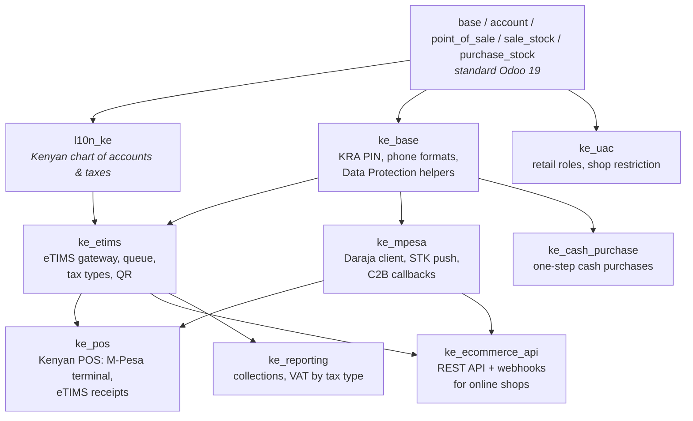
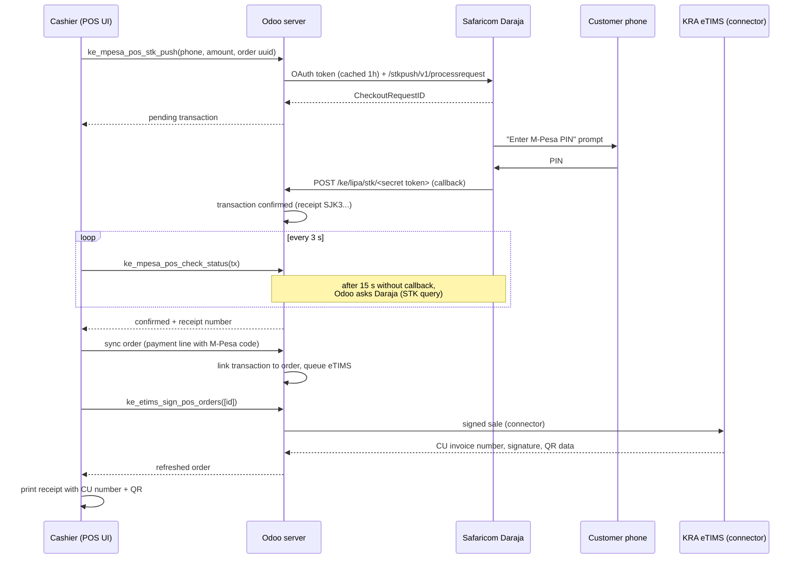
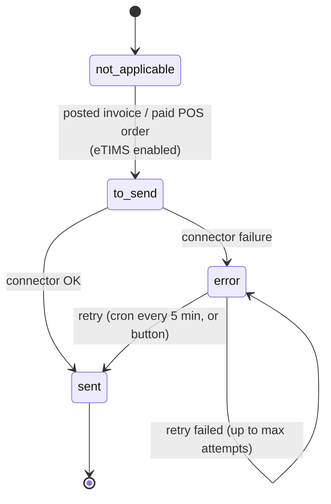

# Architecture

This document explains how the Kenyan ERP/POS stack is put together: the Odoo
modules, how a sale flows through M-Pesa and KRA eTIMS, how tenants are
isolated, and the security model. Read it before changing the code.

- Target: **Odoo 19.0 Community** (`odoo:19.0` Docker image), PostgreSQL 16.
- Everything Kenyan lives in `addons-custom/ke_*`. Standard Odoo apps are
  extended, never forked, so Odoo upgrades stay possible.

## 1. Module map



| Module | Responsibility | Depends on |
|---|---|---|
| `ke_base` | KRA PIN validation/normalisation (`A`/`P` + 9 digits + letter), Kenyan MSISDN normalisation (`2547XXXXXXXX`), phone masking for receipts (Data Protection Act 2019), "KRA PIN" label on the Kenya country record. | `base` |
| `ke_etims` | Connector-agnostic KRA eTIMS layer: per-company settings (branch id, device serial, CU id), eTIMS tax type on taxes (A–E), item master data on products, a transmission **queue** with retries, document mixin used by invoices and POS orders, QR codes on invoices. Ships a *training* connector only. | `ke_base`, `account`, `l10n_ke`, `product` |
| `ke_mpesa` | Safaricom Daraja: M-Pesa accounts (till / paybill + credentials), STK push, STK status query, C2B URL registration, callback endpoints, transaction log, claim/anti double-use logic, crons. | `ke_base`, `account` |
| `ke_pos` | Point of Sale for Kenya: M-Pesa payment terminal (STK push **and** "verify M-Pesa code"), eTIMS signing *before* the receipt prints, receipt (CU number, QR, Lipa na M-Pesa line, KRA PIN), KES 1.00 cash rounding, eTIMS payment types. | `point_of_sale`, `ke_etims`, `ke_mpesa` |
| `ke_ecommerce_api` | REST API + signed webhooks for an online shop: catalog, branch stock, customers, orders, payments (incl. M-Pesa STK via Odoo), deliveries, invoices with eTIMS data. | `ke_mpesa`, `ke_etims`, `sale_stock` |
| `ke_cash_purchase` | Informal cash purchases as a proper PO → receipt → bill → payment chain; no input VAT without a supplier eTIMS invoice. | `purchase_stock` |
| `ke_uac` | Retail roles (Cashier, Branch Manager) and "Allowed shops" per cashier. | `point_of_sale`, `stock`, `purchase` |
| `ke_reporting` | Daily collections by payment method; VAT by eTIMS tax category (VAT3 preparation). | `point_of_sale`, `ke_etims` |

## 2. Key flows

### 2.1 POS sale paid with M-Pesa (STK push)



Design decisions:

- **No client-side trust.** POS users only have *read* access to
  `ke.mpesa.transaction`; all state changes happen in server methods
  (callbacks, status queries, claims). A cashier cannot mark a payment as
  received through JSON-RPC.
- **Callbacks are authenticated by an unguessable URL** (`/ke/lipa/.../<token>`)
  because Daraja does not sign callbacks; an IP allow-list can be added.
  The URLs avoid words Daraja rejects (`mpesa`, `query`, `exe`, `sql`...).
- **Late or lost callbacks**: the POS falls back on Daraja's STK query; a
  cron settles anything still pending; a success callback always wins, even
  after expiry, and an unknown success callback is recorded as an *unclaimed*
  payment so money is never lost.
- **Double use**: a payment is *claimed* atomically (`UPDATE ... WHERE claimed
  IS NOT TRUE`). The same M-Pesa code typed at two tills fails on the second.
  A claim by an order that never completes is released when the order is saved.

### 2.2 POS sale paid to the till ("verify M-Pesa code")

Customers often pay from their phone to the Buy Goods till. Safaricom posts a
C2B confirmation to `/ke/lipa/c2b/confirm/<token>`; Odoo stores it. At the
till, the cashier types the code from the customer's SMS; Odoo finds the
confirmed, unclaimed payment for that till and reserves it for the order. The
line amount becomes the amount actually paid.

### 2.3 eTIMS



- Documents are **queued in the same transaction** that posts them and
  transmitted by a cron in **its own transaction**: an unavailable KRA never
  blocks invoicing, and a rolled-back transaction can never leave a document
  signed at KRA but missing in Odoo.
- The POS asks for an immediate transmission right after saving the order
  (`waitForPushOrder` / `beforePostPushOrderResolve` hooks of Odoo 19) so the
  receipt carries the CU number and QR. If KRA is slow or down, the receipt
  prints "Transmission to KRA pending" and the queue catches up.
- Rows are locked with `FOR UPDATE SKIP LOCKED` before transmission so the
  cron, the POS and a manual button can never sign the same document twice.
- Signed invoices cannot be reset to draft: a credit note (which references
  the original receipt number) is the only correction.
- An invoiced POS order is fiscalized once: the invoice is the fiscal
  document and its eTIMS data is mirrored on the order for the receipt.
- The payload is connector-agnostic (see [ETIMS.md](ETIMS.md)); real OSCU/VSCU
  connectors plug in as separate modules.

### 2.4 Online order (e-commerce API)

```mermaid
sequenceDiagram
    participant S as Online shop backend
    participant O as Odoo (tenant)
    participant D as Daraja
    S->>O: GET /products, /stock (sync catalog)
    S->>O: POST /orders (external_id, customer, lines, delivery/pickup)
    O->>O: customer (KRA PIN), sale order confirmed, stock reserved
    O-->>S: 201 order
    alt Shop collected payment itself
        S->>O: POST /orders/{id}/payments (M-Pesa code / card ref)
    else Odoo collects M-Pesa
        S->>O: POST /orders/{id}/mpesa-stk-push
        O->>D: STK push
        D->>O: callback: confirmed
    end
    O->>O: payment booked; fully paid → invoice posted → eTIMS queue
    O-->>S: webhook payment.received / order.paid / order.invoiced
    O-->>S: webhook invoice.etims_signed (CU number, QR data)
    Note over O: warehouse validates delivery / branch hands over pickup
    O-->>S: webhook order.fulfilled
```

Details in [ECOMMERCE_API.md](ECOMMERCE_API.md) and
[ECOMMERCE_INTEGRATION_GUIDE.md](ECOMMERCE_INTEGRATION_GUIDE.md).

## 3. Multi-tenancy

Two levels, used together:

| Level | Mechanism | Isolation | Typical use |
|---|---|---|---|
| **Tenant** | One PostgreSQL database per tenant, chosen from the sub-domain (`dbfilter = ^%d$`), one filestore per database. | Complete: data, users, configuration, crons, M-Pesa and eTIMS credentials, API keys. | One business (customer of the platform). |
| **Company** | Odoo multi-company inside a tenant database. Every `ke_*` model has `company_id` + multi-company record rules; API keys, M-Pesa accounts and eTIMS settings are per company. | Record rules + per-company technical API users. | Branches registered separately with KRA, or several brands of one owner. |

- Tenants are created, upgraded, backed up and dropped with
  `scripts/tenant.sh` (see [MULTI_TENANCY.md](MULTI_TENANCY.md)).
- Callbacks and API calls reach the right tenant through its host name. API
  clients that cannot use a tenant host can send `X-Odoo-Database` (still
  checked against `dbfilter`).
- The e-commerce API executes as the channel's **technical user**, created
  with the minimum groups and access to its own company only; record rules
  therefore apply to API calls exactly as to humans.

## 4. Security model

| Area | Control |
|---|---|
| M-Pesa credentials | Fields restricted to *M-Pesa / Administrator*; access token cached in a system-only field. |
| M-Pesa transactions | Read-only for users; server-side state machine; atomic claims; raw callback payloads purged after 90 days (Data Protection Act). |
| Callbacks | Secret token in URL (hex, regenerable) + optional IP/CIDR allow-list (`ke_mpesa.allowed_callback_ips`). |
| eTIMS | Training connector refuses production; signed documents immutable; raw responses visible to system admins only. |
| API keys | 256-bit secrets, only SHA-256 hashes stored, shown once, scopes per key, expiry, revocation, last use (time + IP). |
| API execution | Technical user per channel, single company, record rules enforced; every handler runs in a savepoint so a failed call writes nothing. |
| API abuse | Per-key rate limit in Odoo + per-key `limit_req` in nginx; request log with request id; bodies kept only for failed calls, purged after 30 days. |
| Webhooks | HMAC-SHA256 signature with timestamp (`X-KE-Signature: t=...,v1=...`), unique event ids, outbox pattern (sent only after commit). |
| POS | Cashiers restricted to their shops (`ke_uac`); M-Pesa lines cannot be "forced" without Safaricom confirmation unless a manager enables it. |

## 5. Odoo 19 specifics handled

The original scaffold targeted Odoo 19 but used older APIs. The rework fixes:

| Scaffold | Odoo 19 reality | Fix |
|---|---|---|
| `res.groups.category_id` | Groups belong to a `res.groups.privilege` | `ke_uac`, `ke_mpesa`, `ke_ecommerce_api` define privileges |
| `stock.move` `name`, `quantity_done` | `name` removed; `quantity` + `picked` | `ke_cash_purchase` uses the purchase order flow |
| POS JS `send_payment_request`, `@point_of_sale/app/payment/...` | `sendPaymentRequest(uuid)`, `@point_of_sale/app/utils/payment/payment_interface`, `@point_of_sale/app/services/pos_store` | rewritten in `ke_pos` |
| Receipt `props.data` | `OrderReceipt` receives the order record (`props.order`) | rewritten in `ke_pos` |
| `account.move._post` raising when no eTIMS connector | blocked every invoice | queue + training connector |
| POS cash rounding "modify tax" | POS requires "add a rounding line" (company accounts) | `ke_pos` sets per-company accounts |
| `pos_payment_method.name` as text in SQL | translated fields are JSONB | reports use ids, not names |
| `/ke_mpesa/callback` | Daraja rejects URLs containing "mpesa" | `/ke/lipa/...` |
| Charts of accounts | not loaded automatically by a CLI install | `scripts/tenant_setup.py` loads `ke` |

## 6. Tests

Every module ships automated tests (`tests/`), tagged `ke`:

```bash
odoo -d test_db -i ke_pos,ke_ecommerce_api,ke_cash_purchase,ke_uac,ke_reporting \
     --test-enable --test-tags ke --stop-after-init
```

They cover KRA PIN/phone rules, eTIMS queue/retry/credit notes, Daraja calls
(mocked), real HTTP callbacks, POS orders with M-Pesa and eTIMS, double-claim
protection, the full REST API over HTTP (auth, scopes, rate limit, orders,
payments, cancellations with credit notes, STK push, webhooks with signature,
multi-company isolation) and the shop restriction rules.
